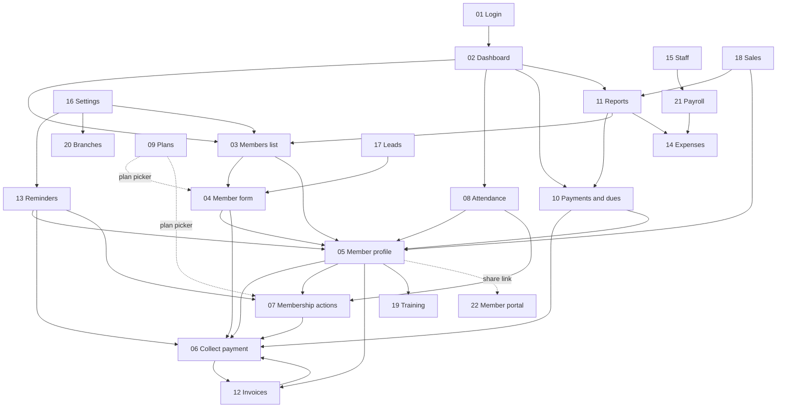

# AGENTS.md – Gym management web app

This file is the entry point for any coding agent or developer working on this project. Read it first, then read the screen file for the screen you are building.

## 1. What we are building

A responsive web app for gym owners and front-desk staff, modelled on the owner side of DGymBook. It runs in the browser on phone, tablet and desktop, and can be installed to the home screen (PWA). It manages members, plans, memberships, payments and dues, attendance, reports, and later staff, leads, sales and training.

**Fixed decisions**
- **Front end:** Next.js (App Router) and Tailwind CSS. PWA support.
- **Back end:** Next.js Route Handlers under `src/app/api`. MongoDB with Mongoose.
- **Hosting:** Vercel. A once-a-day Vercel cron job is optional (marking memberships expired). Nothing depends on it.
- **No automatic messaging.** The app never sends WhatsApp or SMS by itself. It builds the message and opens WhatsApp (a `wa.me` link) so a person presses send. Do not add a messaging provider.
- **Market:** India. Rupees, GST, Asia/Kolkata time.

## 2. How the screen files work

Each screen has one file in `docs/screens/`. A screen file says: route, phase, roles, what it reads and writes, layout, fields, actions with their API calls, which screens it connects to, and a "Done when" checklist.

Rules for agents:
1. Before building or changing a screen, read its file and the files of the screens it connects to.
2. Build to the "Done when" list. Tick it in the file when finished and set the status in section 4.
3. If you change a route, field, API call or connection, update the screen file and every file that points to it in the same change.
4. If a screen file and this file disagree, this file wins for conventions (section 6), the screen file wins for that screen's behaviour. Fix the disagreement.

## 3. Screen index

| # | Screen | Route | Phase | File |
| --- | --- | --- | --- | --- |
| 01 | Login and register | `/login`, `/register` | 1 | `docs/screens/01-login.md` |
| 02 | Dashboard | `/` | 1 | `docs/screens/02-dashboard.md` |
| 03 | Members list | `/members` | 1 | `docs/screens/03-members-list.md` |
| 04 | Add or edit member | `/members/new`, `/members/[id]/edit` | 1 | `docs/screens/04-member-form.md` |
| 05 | Member profile | `/members/[id]` | 1 | `docs/screens/05-member-profile.md` |
| 06 | Collect payment (modal) | none | 1 | `docs/screens/06-collect-payment.md` |
| 07 | Membership actions (modals) | none | 1–2 | `docs/screens/07-membership-actions.md` |
| 08 | Attendance | `/attendance` | 1 | `docs/screens/08-attendance.md` |
| 09 | Plans | `/plans` | 1 | `docs/screens/09-plans.md` |
| 10 | Payments and dues | `/payments` | 1 | `docs/screens/10-payments-dues.md` |
| 11 | Reports | `/reports` | 1–2 | `docs/screens/11-reports.md` |
| 12 | Invoices | `/invoices`, `/invoices/[id]`, `/i/[token]` | 2 | `docs/screens/12-invoices.md` |
| 13 | Reminders | `/reminders` | 2 | `docs/screens/13-reminders.md` |
| 14 | Expenses | `/expenses` | 2 | `docs/screens/14-expenses.md` |
| 15 | Staff | `/staff`, `/staff/new`, `/staff/[id]` | 2 | `docs/screens/15-staff.md` |
| 16 | Settings | `/settings` | 2 | `docs/screens/16-settings.md` |
| 17 | Leads | `/leads` | 3 | `docs/screens/17-leads.md` |
| 18 | Sales | `/sales` | 3 | `docs/screens/18-sales.md` |
| 19 | Training | `/members/[id]/training` | 3 | `docs/screens/19-training.md` |
| 20 | Branches | `/settings/branches` | 3 | `docs/screens/20-branches.md` |
| 21 | Payroll | `/staff/payroll` | 3 | `docs/screens/21-payroll.md` |
| 22 | Member portal | `/portal/[token]` | 3 | `docs/screens/22-member-portal.md` |

## 4. How screens connect

**Navigation.** Phone: bottom tabs **Home** (02), **Members** (03), **Attendance** (08), **Payments** (10), **More**. "More" lists Plans (09), Reports (11), Invoices (12), Reminders (13), Expenses (14), Staff (15), Settings (16), and from phase 3 Leads (17), Sales (18). Desktop: the same items in a left sidebar. A floating plus button offers Add member (04), Collect payment (06) and Mark attendance (08).



**Reading the graph.** Arrows go from the screen where the user is to the screen they can reach. A dotted arrow is a data link (a picker or a shared link), not a page change. The "Connects to" section of each screen file lists the same links in words and must stay in step with this graph.

**Shared data between screens**
- Plans (09) feed the plan pickers in 04 and 07.
- A membership sale always creates an invoice, which 06 pays and 12 shows.
- Payments recorded in 06 and 18 feed 02, 10 and 11.
- Attendance rows from 08 feed 02, 05 and 11.
- Settings (16) hold the tax default, "expiring soon" days and message templates used by 02, 03, 08, 12 and 13.
- Branch choice (20) filters every list and report.

## 5. Build order

| Step | Build | Screens |
| --- | --- | --- |
| 0 | Project setup, MongoDB connection, auth, session cookie, role checks, `gymId` scoping, app shell with navigation, shared components | 01 |
| 1 | Plans and members | 09, 04, 03, 05 |
| 2 | Memberships, invoices and payments | 07 (renew, freeze, resume), 06 |
| 3 | Attendance, then dashboard and reports | 08, 02, 10, 11 |
| 4 | Phase 1 release to one real gym | |
| 5 | Phase 2 | 12, 13, 14, 15, 16 (import), rest of 07 |
| 6 | Phase 3 | 17, 18, 19, 20, 21, 22 |

## 6. Conventions

**Folders**
```
src/app/(auth)/login, register
src/app/(app)/layout.tsx          app shell, bottom tabs, sidebar
src/app/(app)/page.tsx            dashboard
src/app/(app)/members, attendance, plans, payments, reports,
              invoices, reminders, expenses, staff, settings, leads, sales
src/app/portal/[token], src/app/i/[token]
src/app/api/...                   Route Handlers, one folder per resource
src/models/                       Mongoose models
src/lib/                          db.ts, auth.ts, rbac.ts, money.ts, dates.ts,
                                  whatsapp.ts, validation (zod schemas)
src/components/                   shared UI
docs/screens/                     the screen files
```

**Multi-tenancy.** Every document has `gymId`. Every query includes it, taken from the session, never from the request body. Documents that belong to a location also have `branchId`.

**Auth and roles.** JWT in an httpOnly, secure, SameSite=Lax cookie. Check role and `gymId` in every Route Handler through `lib/rbac.ts`. Hiding a button is never enough.

| Role | Can | Cannot |
| --- | --- | --- |
| Owner | Everything in all branches | |
| Manager | Everything in their branches except the app's own account settings | See other branches |
| Receptionist | Add members, renew, take payments, mark attendance, share reminders, sell products | Void payments, see profit reports, change plans |
| Trainer | View assigned members, log sessions, plans | See payments or other trainers' members |
| Member | Read own data in the portal | Anything else |

**API.** JSON in, JSON out: `{ data }` on success, `{ error: { code, message } }` on failure. Validate input with zod. List endpoints take `page`, `search`, filters and `branchId`. Use HTTP status codes properly (401, 403, 404, 409 for duplicates, 422 for validation).

**Money.** Store amounts as integer paise. Format with `Intl.NumberFormat('en-IN')` and the ₹ sign (for example ₹1,00,000). Never use floating point for totals.

**Dates and time.** Store UTC. Show and calculate days in Asia/Kolkata. End date = start date + plan duration days.

**Phone numbers.** Store digits with country code (for example `919876543210`). Unique per gym on `members`.

**Status rules (one source of truth, in `lib/status.ts`)**
- A membership is stored as `active`, `expired`, `frozen` or `ended`. Treat an `active` membership whose end date is before today as expired when reading, even if no job has run.
- **Expiring soon** is a badge on an active membership ending within N days (setting, default 7). It is not stored.
- A member's shown status is from their latest membership: Frozen, Active, Expiring, Expired, Ended, or No plan.
- **Dues** = sum of invoice balances above zero.
- Only Renew moves an expired membership back to active. See screen 07.

**Records that must not disappear.** Payments are never deleted, only voided. Membership changes, voids, deletes and role changes write an `auditLog` row (who, what, when, why).

**WhatsApp sharing.** One helper in `lib/whatsapp.ts`: `buildShareLink(phone, message)` returns `https://wa.me/<digits>?text=<encoded message>`. All Share buttons use it. Messages come from templates with `{name}`, `{plan}`, `{endDate}`, `{amount}`, `{gym}`. Record shares in `messages` (`memberId`, `type`, `sharedAt`, `sharedBy`) but never block opening WhatsApp on that write.

**Shared components** (build once, reuse): AppShell, BottomTabs, Sidebar, BranchSwitcher, SearchBox, FilterChips, StatusBadge, MemberCard, MoneyText, DateText, ConfirmDialog, BottomSheet/Drawer, EmptyState, ResponsiveList (cards on phone, table above 900 px), ShareButton, PhotoUploader, PlanPicker, PaymentSplitRows, Toast.

**UI rules.** Phone first, usable at 360 px wide. Three taps or fewer from the member profile to renew, collect payment or mark attendance. Status uses colour plus a word. Every list has search, filters, an empty state and a loading skeleton.

## 7. Data model summary

Collections: `gyms`, `branches`, `users`, `members`, `plans`, `memberships`, `invoices`, `payments`, `attendance`, `expenses`, `leads`, `products`, `sales`, `messages`, `ptSessions`, `dietPlans`, `workoutPlans`, `parqForms`, `payrollRuns`, `auditLog`.

Additions made while writing the screen files (compared with the planning doc):
- `plans.sessions` (optional PT session count).
- `users.payroll` (base salary, commission percent) and `payrollRuns`.
- `members.portalTokenHash` and `invoices.shareToken` for the shared links.
- `workoutPlans`, alongside `dietPlans`.
- `messages` is the log of reminders a person shared. It holds no scheduled or sent states.

Indexes on day one: `members(gymId, phone)` unique, `members(gymId, name)`, `memberships(gymId, status, endDate)`, `payments(gymId, receivedAt)`, `attendance(gymId, checkInAt)` and `attendance(memberId, checkInAt)`.

## 8. Do not

- Send any message automatically, or add a WhatsApp or SMS provider.
- Delete payments or invoices.
- Trust `gymId`, role or `branchId` from the client.
- Store money as floating-point numbers.
- Build phase 3 screens before phase 1 is working with a real gym.
- Add biometric device integration, online payment gateway or AI workouts in the first release.

## 9. Screen status and progress log

### Detailed screen status

| # | Screen | Route | Phase | Status | Notes |
| --- | --- | --- | --- | --- | --- |
| 01 | Login and register | `/login`, `/register` | 1 | **Done** | Multi-tenant org onboarding, JWT httpOnly cookie auth, Alpha Warriors branding |
| 02 | Dashboard | `/` | 1 | **Done** | Real-time stats (Active Warriors, Check-ins, Revenue, Dues), quick shortcuts |
| 03 | Members list | `/members` | 1 | **Done** | Search, status filters, mobile cards / desktop table, responsive list |
| 04 | Add or edit member | `/members/new`, `/members/[id]/edit` | 1 | **Done** | Canvas photo resizing, unique phone check, initial plan & split payments |
| 05 | Member profile | `/members/[id]` | 1 | **Done** | History tabs (Memberships, Invoices, Attendance, Notes), digital QR modal |
| 06 | Collect payment (modal) | UI component | 1 | **Done** | Multi-mode split rows (Cash, UPI, Card, Bank), auto balance update |
| 07 | Membership actions | Modals on `05` | 1–2 | **Done** | Renew, Freeze, Resume, Extend, Upgrade (unused credit), Terminate |
| 08 | Attendance | `/attendance` | 1 | **Done** | Fast-search check-in, 1-tap undo, QR scanner modal, Missed 7+ days tab with WhatsApp |
| 09 | Plans | `/plans` | 1 | **Done** | Subscription packages, GST tax calculation, session quotas, active toggle |
| 10 | Payments and dues | `/payments` | 1 | **Done** | Transactions log, mode breakdowns, pending dues list with WhatsApp remind |
| 11 | Reports | `/reports` | 1–2 | **Done** | Daily attendance, expiring memberships, monthly revenue, trends, CSV export |
| 12 | Invoices | `/invoices`, `/invoices/[id]`, `/i/[token]` | 2 | **Done** | Print stylesheet, public verified receipt page (`/i/[token]`), revocable share token |
| 13 | Reminders | `/reminders` | 2 | **Done** | Expiring, Expired, and Dues tabs; Next-member queue mode; manual WhatsApp links |
| 14 | Expenses | `/expenses` | 2 | **Done** | Monthly overhead picker, category pills, soft delete; Owner & Manager only |
| 15 | Staff | `/staff`, `/staff/new`, `/staff/[id]` | 2 | **Done** | Role assignment, one-time temporary passwords, WhatsApp credential sharing, RBAC |
| 16 | Settings | `/settings` | 2 | **Done** | Gym profile, GSTIN, billing sequences (`INV-`, `AW-`), templates, CSV dry-run import |
| 17 | Leads | `/leads` | 3 | **Done** | Pipeline CRM, walk-in inquiries, trial workouts, overdue follow-ups first, 1-tap convert to member |
| 18 | Sales | `/sales` | 3 | **Done** | POS merchandise/supplements cart, stock tracking, low-stock badges, split payments, receipts, void with stock restoration |
| 19 | Training | `/members/[id]/training`, `/parq/[token]` | 3 | **Done** | Workout routines, meal plans, PT session quotas, digital PAR-Q questionnaire with medical advisories |
| 20 | Branches | `/settings/branches` | 3 | **Done** | Multi-location management, header branch switcher, RBAC location scoping |
| 21 | Payroll | `/staff/payroll` | 3 | **Done** | Monthly base salary + sales commissions, leave deductions, 1-click payout feeding salary expenses |
| 22 | Member portal | `/portal/[token]` | 3 | **Done** | Athlete self-service pass: digital check-in QR, remaining days, invoice receipts, workouts & diet |

---

## 10. Implemented Architecture & Design Conventions (For Future Agents)

1. **Brand & Theme Styling**:
   - **Logo**: Stored at `public/logo.jpg` (Alpha Warriors badger emblem with "TRAIN • PUSH • DOMINATE").
   - **Primary Palette**: Crimson Red (`#DC2626`, `red-600`, `red-700`) accenting buttons, active tabs, and badges.
   - **Dark Slate / Obsidian**: `slate-950` / `slate-900` for headers, desktop sidebar, and summary totals cards.
   - **Card Containers**: White cards with subtle borders (`border-gray-200/80`) on clean background (`#F8FAFC`).
   - **Tailwind Setup**: Tailwind CSS v3 with PostCSS and Autoprefixer (`tailwind.config.ts`, `postcss.config.mjs`). Do not switch to experimental v4 without verifying Next.js Webpack loader compatibility.

2. **Core Collections Implemented**:
   - `Gym`: Organization metadata, GSTIN, state, logo, billing prefixes, alert thresholds, message templates.
   - `Branch`: Gym location branches, active status, multi-branch scoping.
   - `User`: Accounts with roles (`owner`, `manager`, `receptionist`, `trainer`, `member`), hashed passwords, active status, payroll configuration.
   - `Member`: Unique per gym phone number, memberCode (`AW-1001`), photo, joined date, soft delete flag, `portalTokenHash`.
   - `Plan`: Duration in days, price in paise, GST tax %, session quotas.
   - `Membership`: Active/expired/frozen/ended subscriptions linked to member and plan.
   - `Invoice`: Sequential invoice numbers (`INV-0001`), totalAmount, paidAmount, balance in paise, public `shareToken`.
   - `Payment`: Append-only, never deleted, `modes` array (Cash, UPI, Card, Bank), `isVoid` flag with audit log.
   - `Attendance`: Check-in timestamps, check-in source (`desk`, `qr`, `portal`), member reference.
   - `Expense`: Facility overhead costs, categories (rent, electricity, salary, equipment, maintenance, marketing, other), soft delete.
   - `Message`: Non-blocking audit log of WhatsApp reminder messages shared by staff.
   - `AuditLog`: Immutable change history for security-sensitive actions.
   - `Lead`: Prospective athlete pipeline (new, contacted, trial, won, lost), overdue follow-ups, convert to member.
   - `Product`: Supplements & merchandise catalog, integer paise price & cost (cost hidden from receptionists), stock, low-stock threshold.
   - `Sale`: POS sales records, multi-item cart, guest/member customers, payment mode splits, stock management, void action.
   - `WorkoutPlan`: Weekly routine builder (days, exercises, sets, reps, notes), versioning, WhatsApp sharing.
   - `DietPlan`: Meal timing & nutrition chart (time, meals, calories, protein), versioning, WhatsApp sharing.
   - `PTSession`: 1-on-1 coaching logs deducting from plan session quotas.
   - `PARQForm`: 7 standard physical readiness questions, digital signature, medical risk flag, immutable submissions.
   - `PayrollRun`: Monthly payroll calculations (base salary + sales commissions - deductions), 1-click disbursement feeding Expense.

3. **Security & Production Verification**:
   - Every Route Handler validates `gymId` multi-tenancy and checks roles via `requireAuth()`.
   - Financial amounts stored strictly as integer paise.
   - Trainer access strictly restricted to assigned members.
   - Secret-free public URLs: verified receipts `/i/[token]`, member self-service portal `/portal/[token]`, and PAR-Q questionnaire `/parq/[token]` use unguessable SHA-256 tokens.
   - Manual WhatsApp links only (`wa.me`); no automatic SMS or messaging bots.
   - Verified with Next.js 16 production build (`next build --webpack` with 0 errors across all 49 pages and API endpoints).
